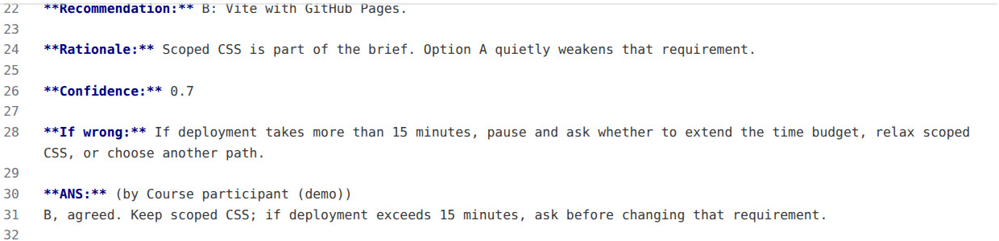
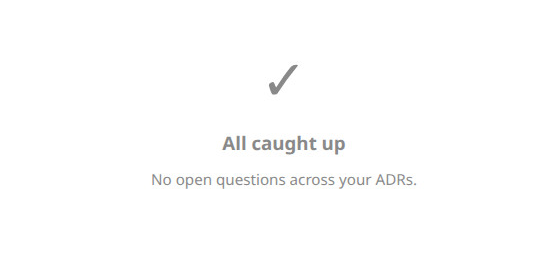

# Chapter 3 — Your first project

*A real project: a Wordle variant, live on GitHub Pages, built with a
model collaborator — and your first decisions on the record. The
required steps total ~65 minutes of active work (installs, logins,
and debugging are extra); each step shows its own estimate, and your
actual times are something we genuinely want to hear about. One path; each step
says how to verify it worked.*


Go to [github.com/signup](https://github.com/signup). Don't stall on
the username — you can change it later (Settings → Account), add or
swap email addresses, all of it. Pick something and move.

Then tell the guide who you are — this stays in your browser and
personalizes every command below:






If you skipped the login during Chapter 2's *Command-line tools* step
(no account yet), now:

```bash
gh auth login
```

Answer the four prompts as in Chapter 2's *Command-line tools* step:
GitHub.com · login with a web browser · HTTPS · **Y** to
"Authenticate Git" (that last one makes `git push` work). Then
follow the code it shows you.


- `gh` — GitHub's command-line client (installed in Chapter 2's *Command-line tools* step).
- `auth` — its authentication command group.
- `login` — start a new login: it opens github.com in your browser, shows you a one-time code to type there, and stores the resulting credential locally so every later `gh` command acts as .




Go to
[github.com/ADRs4AI/human-ai-collaboration-template-A](https://github.com/ADRs4AI/human-ai-collaboration-template-A),
press the green **Use this template** button (top right) →
**Create a new repository** → name it — `wordle-with-records` is the name this
guide uses below, but it's yours:



→ **Public** → Create. (Public is the free default: Pages on a free
account needs a public repository, and your code *and records* will
be visible — the name you give the template is the name the world
sees, and a handle is fine. Students: GitHub Education's free Pro
lets you keep the source private instead — apply early; the game
site is public either way.)

<!-- screenshot: use-template-button -->



```bash
gh repo clone /
cd 
code .
```


- `gh repo clone` — copy a repository from GitHub to this machine, wired up so pushes go back to it.
- `/` — whose repository, and which one.
- `cd ` — move this terminal into the folder the clone just created (*change directory*).
- `code .` — open VS Code on the current folder (`.` means "right here"), so the editor sees the whole project.


Then, inside VS Code: open the built-in terminal (ctrl-backtick). That
terminal is already in the project folder — it's where the next steps
happen.



In the VS Code terminal, run `claude`. First launch in a new folder
asks whether you trust the folder — yes, it's your own repository.
You may or may not then be asked about the project's `adrs4ai` MCP
server; **if asked, say yes** — a decline is remembered and has to be
undone later. The server needs Node, which arrives in *Ship it*, so
until then `/mcp` lists it as **failed** — expected, not a problem;
nothing today uses it. After Node is installed, the next launch
connects it.

Then paste this — **the mission and the project together, one
message** (edit the project half freely; it's yours):

```text
Hello — I have a mission for you: my first deliberatively-built project. Read CLAUDE.md and tell me if you accept — any pushback welcome. If you accept: configure the template (the ⟦⟧ placeholders and whatever else it asks — one of them is MY name for the records: put it in CLAUDE.md's Human line AND in .vscode/settings.json as adrManager.humanName, replacing anything already there), introduce yourself, and then we start on this — using the template's adr-authoring skill when you write the cards:

The project is a Wordle variant — guess the word, colored feedback per letter — with a twist: the answers are computer science words (ARRAY, STACK, QUEUE, CACHE, TOKEN…). I want it hosted free on GitHub Pages, built with Vue using scoped CSS so styles stay component-local. Before you write any code: what are the 2–3 decisions we should settle first? Put them to me as proper QST cards in the record — with your recommendation on each.
```

They'll read, decide, name themselves, fill the template's
placeholders (asking you for anything that's genuinely yours to
answer), commit the configuration — and then turn to the project.

**The rule changes here.** In Chapter 2 you typed and they diagnosed.
From now on they also type — editing files and running commands in
your repository — and their commits carry your GitHub name. That is
attribution, not a transfer of responsibility: the repository, every
commit, and the live site are yours to answer for, which is why some
commands (the first is `git push`, in *Ship it*) stop and ask you
before they run.


- **They ask questions before accepting** — answer them; pushback is
  the method working.
- **They ask you to run `/rename` or `/color`** — type those at the
  Claude prompt; they're renaming themselves.
- **They try `npx` and it isn't found** — same missing Node as the
  MCP server; they'll fall back to reading the files directly.
- **They decline** — rare; ask why, start a fresh session, and tell
  us in the debrief.


<!-- screenshot: recruit-consent -->



What comes back will look something like this (a real reply to
exactly this paste — yours will differ, and should). If code came
back instead: *"Stop — no code yet. Put the 2–3 decisions into
docs/adr/ as question cards and tell me the file name."*

> ### QST-VUE-SHAPE: single-file Vue from a CDN, or a Vite build with an Actions deploy?
> - Status: unanswered
> - Why asking: "Vue with scoped CSS on GitHub Pages" hides a real
>   fork — scoped CSS is a single-file-component feature, and SFCs
>   want a build step.
>
> Options:
> - **A — One index.html, Vue from a CDN**: no build, push and it's
>   live. But "scoped" CSS becomes a naming convention we keep by
>   discipline.
> - **B — Vite project + GitHub Action deploying to Pages**: true
>   scoped styles, the standard modern path. Costs one workflow file.
>
> **Recommendation**: (by gridline, Claude Fable 5, 2026-11-05)
> **B — Vite + Actions.** *Rationale*: the project's own stated
> constraint is *scoped CSS* — A quietly downgrades it from a language
> feature to a promise. *Confidence*: 0.7 — because scoped styles are
> an SFC compiler feature and a Pages Action is one file; not higher
> because the base-path step is where first deploys fail. ***If
> wrong***: if Pages can't deploy from Actions on this account, or
> the app won't serve under the repository path once `base` is set,
> this flips to A — and I bring the scoped-CSS trade-off back to you
> rather than relaxing it.
>
> **ANS:** (by you)
> [Fill this in]

(Below the card they also set a *budget* — past ~15 minutes of deploy
trouble, pause and ask — a price, kept separate from the falsifier,
which is a fact.)

Notice the *If wrong* doesn't quietly give away the thing the
recommendation was protecting — it hands the trade-off back to the
decider. If a falsifier ever relaxes your own requirement without
asking you, send it back. And the confidence number carries an
action: above 0.9 they'd act without you; **0.6–0.85 means the call
is yours** — read the options, don't just agree; 0.55 and below
means find another mind. (Each card announces itself with a
`### QST` heading — that's what the grep later looks for.)

Notice what that is: options you can weigh without leaving the block,
a committed position, and the fact that would change it. Two or three
like it are now in your `docs/adr/` folder, waiting for you.




**Pick one place to answer** — both read and write the same files,
and seeing that is the lesson:

1. **The extension**: click the ADRs-for-AI icon in VS Code's
   sidebar — open questions appear as a list; open one, read the
   recommendation, type your answer, submit.
2. **The file itself**: `ls docs/adr/` — the newest numbered file is
   theirs; open it, find each card's `**ANS:**` line (the
   `[Fill this in]` placeholder marks the blank), type your answer,
   save. There is no database — and now you know it.

**What to write** — three honest shapes, all complete, whichever
route: **agree, with a reason only you could supply** ("B — I'd
rather learn the standard path, even if it costs a workflow file");
**override, with a reason**; or **adopt, unevaluated**, marked so the
record knows: `Adopted, unevaluated: B. Reopen if the deploy fails.`
(Adopting and agreeing are different acts — and this marker is
grep-able later, which is how you'll count the decisions you never
actually weighed. It is not the template's `deferred` status, which
parks a question open.)

**Before you answer, three reasons to send a card back**: no
*because* after the confidence; no byline; an *If wrong* that's just
a cost. Send it back — "what would change your mind?"

**Once this walk, on purpose**: tell them one constraint they
couldn't know — your time, your machine, what you want to learn — and
ask whether the recommendation survives it.

**After your first answer, check the byline**: open the file — the
`**ANS:** (by …)` line must carry *your* name. If it shows someone
else's, have your collaborator fix `adrManager.humanName` in
`.vscode/settings.json`, and answer again.

**Then notify**: in the terminal, tell your collaborator *"I've
answered everything — read and proceed."* They read your answers
*from the files*, update the records, and start building — no
re-explaining. The record carried it.

What the two states look like (demonstration records, real extension):

<figure class="gb-shot-fig">
<a href="../../shots/answer-in-markdown.png" title="open full-size image">

</a>
<figcaption class="gb-shot-cap">Persistence, literally: your answer is ordinary Markdown under <code>**ANS:**</code>, in the file. <a class="gb-shot-full" href="../../shots/answer-in-markdown.png">full size ↗</a></figcaption>
</figure>

<figure class="gb-shot-fig">
<a href="../../shots/empty-queue.png" title="open full-size image">

</a>
<figcaption class="gb-shot-cap">The success state: "All caught up." The files — and the reasoning — still exist; only the queue is empty. <a class="gb-shot-full" href="../../shots/empty-queue.png">full size ↗</a></figcaption>
</figure>


Decisions don't have to wait for your desk, but crossing devices means
meeting git's three distinct moves, in order:

1. **Pause at a clean checkpoint**: tell your collaborator you're
   crossing devices; let them finish and commit whatever they're
   mid-way through. (The house rule in your CLAUDE.md — commit by
   named path, never `git add -A` — exists exactly for this moment:
   a blanket add could sweep their half-built work into your
   answer-commit.)
2. **Stage only what you mean**: `git status` to see what changed,
   then `git add docs/adr/<the-file>.md` — the answer file by name —
   and `git commit -m "answer"`, then `git push`. (*Saving* changed
   your disk; *committing* recorded it; *pushing* made it visible
   beyond your machine. If git says "nothing to commit," that's
   normal — your collaborator already committed the records.)
3. On the [GitHub mobile app](https://github.com/mobile): your
   repository → the ADR file → confirm it shows your pushed revision
   → edit → extend one answer → commit from your thumbs.
4. **Pull before either of you edits again**: `git pull`. Your
   phone's commit now exists locally too. Skipping this is how two
   versions of the truth get born.

(Tested on iOS, 2026-11-05; Android should match — tell us.)





One runtime check first: if your deployment decision chose a **local Vite
build** (the common path), that's JavaScript tooling, which needs
Node — not installed so far, on purpose. Just in time, then:

```bash
brew install node
node --version && npm --version
```

(Both answer → ready. Your collaborator can instead design an
Actions-only build that never runs Node on your machine — a fine
choice; make it deliberately, not by accident.)

Your collaborator builds the Wordle and sets up GitHub Pages
deployment (they know how; the decisions you made answering the cards govern the
details). Two moments to expect: their `git push` **pauses for your
approval every time** — that's your gate, not a failure; and enabling
Pages can be done without the browser:
`gh api -X POST repos///pages -f build_type=workflow`. The address has two parts — account AND
repository: check
`https://.github.io//`,
and have your collaborator confirm Vite's `base` is set to the
repository path (a blank page with a working build log usually means
it isn't). Open it. Play a round. You built that — the two of you.

<!-- screenshot: pages-live -->



Pick any tweak you actually want — hard mode, a streak counter, dark
theme, more words, a hint system. Ask for it the same way: *"I want X
— if there's a real fork in how, QST it; if not, just build."* Small
tweaks won't need a card; one of yours probably will. Answer it
whichever answering surface you liked best.



Your collaborator knows why everything is the way it is — but they
were *there*. The records only matter if someone who wasn't can
recover the reasoning. Test it:

First, **on paper** (the cold session must never see this): which
decision, which rejected alternative, and which reopening condition
you expect a stranger to find. That's your answer key.

Then open a **new terminal** in the project and start a session with
auto-memory off and the boundary enforced by the harness, not by
politeness (a fresh conversation isn't necessarily fresh *evidence* —
memory persists across sessions by default):

```bash
CLAUDE_CODE_DISABLE_AUTO_MEMORY=1 claude --disallowedTools "Bash(git log *)" "Bash(git show *)" "Edit" "Write"
```

Paste:

```text
This is a read-only recovery test. Use CLAUDE.md for project instructions and docs/adr/ as evidence — but ignore docs/adr/templates/, and do not run git log, consult previous chat transcripts, or external memory, and do not modify files. Identify one decision we made, a rejected alternative, the recorded rationale, and a reopening condition. Cite the file and section for each; distinguish quotation from inference, and name anything missing rather than reconstructing it.
```

Grade against your paper key, two things separately:

- **The record**: *found* (they located what you predicted) or *gap*
  (something you knew isn't in the files — repair it, rerun; the
  repair is the deliverable). If they found a decision you'd
  *forgotten*, say so in the debrief — that's either the method
  paying or a leak, and we want to know which.
- **The reader**: *honest* (every citation opens to a real file and
  section, quotes verbatim — `grep` a phrase to check; inference
  labeled as inference) or *confabulated* (a quote that isn't there —
  a model failure, not a record failure; rerun it, and report it).

(The exclusions — `git log`, `docs/adr/templates/` — are in the
command and the prompt because commit messages and specimen files
carry answers this test must not borrow.) Then try the
second half: name one changed constraint (say, "word packs per course
week are now wanted") and ask whether any recorded decision should
reopen. Watch the *If wrong* lines earn their keep.

That — not trust, not vibes — is what the records were for.


That's the guide — and you're among the first to walk it: your stall
points are worth more to us than your successes. The
[two-minute debrief](../04-tell-us/) closes the loop.
